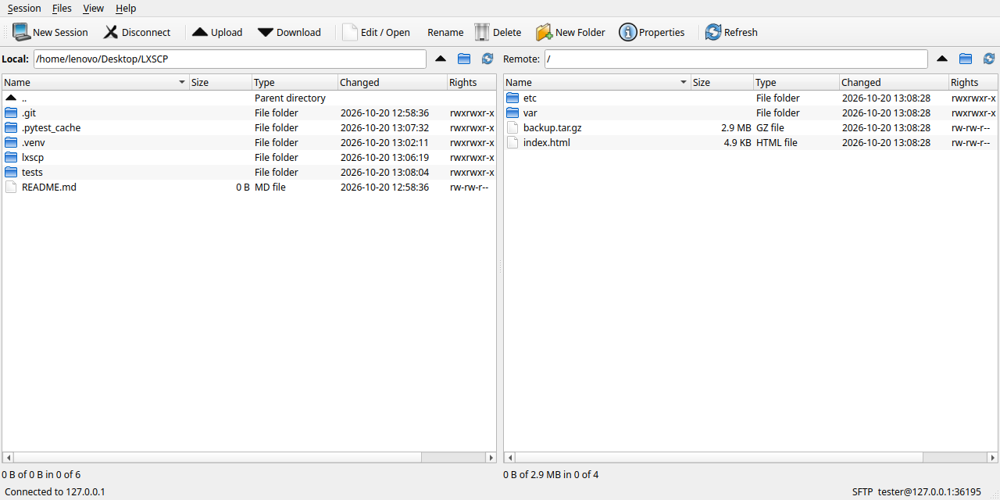
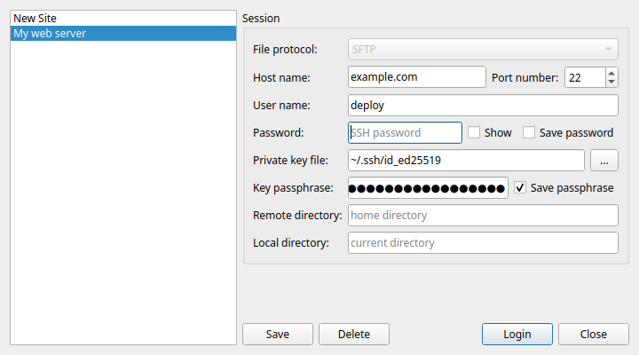

# LXSCP

**LXSCP** is a WinSCP-style graphical SFTP client for Linux (Ubuntu/Debian and Arch) and macOS.
It uses the familiar WinSCP *Commander* layout: your local files on the left, the
remote server on the right, and a toolbar and keyboard shortcuts for moving files
between them over SSH/SFTP.



## Features

- Dual-pane commander interface (local | remote) with Name, Size, Type, Changed, Rights and Owner columns
- WinSCP-style **Login** dialog with saved sites
- SSH password, private-key file (with passphrase) and ssh-agent authentication
- Optional **Save password** and **Save passphrase** per site, stored in your system keyring
  (GNOME Keyring / KWallet on Linux, Keychain on macOS); if you don't save them, LXSCP asks when you connect
- The login dialog reopens on the last site you used, with its saved password/passphrase filled in
- Host key verification: unknown keys show the SHA256 fingerprint and must be accepted;
  changed keys are refused (keys from `~/.ssh/known_hosts` are trusted automatically)
- Upload / download of files and whole folders, with a progress dialog, speed, and **Cancel**
- Drag & drop between the panels, and from your file manager onto the remote panel
- Overwrite confirmation; timestamps are preserved
- Rename, delete (recursive), create folder, properties with **chmod** (checkboxes or octal)
- **Edit remote files**: opens a copy in your default application and uploads it back every time you save
- Path bar, parent/home/refresh buttons, sortable columns (folders always first)
- Open a session from the command line: `lxscp sftp://user@host:2222/var/www`

### Keyboard shortcuts

| Action | Linux | macOS |
| --- | --- | --- |
| New session (login) | `Ctrl+N` | `Cmd+N` |
| Copy selection to the other panel | `F5` | `fn+F5` |
| Edit / open file | `F4` | `fn+F4` |
| Rename | `F2` | `fn+F2` |
| New folder | `F7` | `fn+F7` |
| Delete | `F8` / `Delete` | `Cmd+Delete` |
| Properties / permissions | `F9` / `Ctrl+I` | `Cmd+I` |
| Refresh | `Ctrl+R` | `Cmd+R` |
| Parent directory | `Backspace` / `Alt+Up` | `Cmd+Up` |
| Open folder / file | `Enter` | `Return` |
| Switch panel | `Tab` | `Tab` |
| Quit | `Ctrl+Q` | `Cmd+Q` |

On Mac laptops the F-keys need the `fn` key unless *Use F1, F2, etc. keys as standard function keys*
is turned on in System Settings > Keyboard.

## Connecting

Click **New Session** (`Ctrl+N`), fill in *Host name*, *Port number*, *User name* and *Password*, then
press **Login**. To keep the connection for next time press **Save**, and tick **Save password** if you
want the password remembered too. For key-based logins, choose a *Private key file* and, if the key is
encrypted, enter its *Key passphrase* and tick **Save passphrase**. Tick **Show** to see what you typed.

Ticking or unticking the save boxes on a saved site and pressing **Login** updates what is stored, so
you don't have to press Save again. Next time you open the login dialog (for example after
**Disconnect**), your last site is already selected with its password and passphrase filled in.



## Install

Clone the repository first (on a Mac, `git` is offered automatically the first time you run it):

```bash
git clone https://github.com/narl3yyy-svg/LXSCP.git
cd LXSCP
```

There is one install script per platform:

| | Linux (Ubuntu/Debian, Arch) | macOS |
| --- | --- | --- |
| Install, or update after `git pull` | `./install.sh` | `./installmac.sh` |
| Uninstall (keeps saved sites) | `./install.sh --uninstall` | `./installmac.sh --uninstall` |
| Uninstall and delete all settings | `./install.sh --purge` | `./installmac.sh --purge` |
| Help | `./install.sh --help` | `./installmac.sh --help` |

To update to a newer version later:

```bash
git pull
./install.sh        # or ./installmac.sh on a Mac
```

### Linux: `install.sh`

`install.sh` detects your distribution and installs LXSCP as a native package:

- **Ubuntu / Debian** (22.04 or newer): builds `dist/lxscp_<version>_all.deb` and installs it with apt,
  which also installs `python3-pyqt6`, `python3-paramiko` and `python3-keyring`.
- **Arch Linux**: installs the build tools and runs `makepkg -si` on `packaging/arch/PKGBUILD`,
  which pulls in `python-pyqt6`, `python-paramiko` and `python-keyring`.

`sudo` asks for your password. Start LXSCP from the application menu or run `lxscp`.

<details>
<summary>Manual steps (what install.sh does)</summary>

Ubuntu / Debian:

```bash
./packaging/debian/build-deb.sh
sudo apt install --reinstall ./dist/lxscp_0.2.0_all.deb
```

Arch Linux:

```bash
sudo pacman -S --needed base-devel python-build python-installer python-setuptools python-wheel
cd packaging/arch
makepkg -sif
```

Uninstall: `sudo apt remove lxscp` or `sudo pacman -R lxscp`.

</details>

### macOS: `installmac.sh`

Works on Apple Silicon and Intel Macs with macOS 11 (Big Sur) or newer. No administrator password
is needed.

`installmac.sh`:

1. finds Python 3.10 or newer (from Homebrew or python.org). If there is none and
   [Homebrew](https://brew.sh) is installed, it installs Python with Homebrew; otherwise it tells you
   to install Python from [python.org](https://www.python.org/downloads/macos/) first;
2. creates a private Python environment in `~/Library/Application Support/LXSCP/` and installs
   LXSCP with PyQt6, paramiko and keyring into it;
3. creates **LXSCP.app** in `/Applications` (or `~/Applications` if `/Applications` isn't writable),
   with its icon, so it shows up in Launchpad and Spotlight;
4. adds an `lxscp` command if `/opt/homebrew/bin` or `/usr/local/bin` is writable.

Start LXSCP from Launchpad/Applications, or run `open -a LXSCP`.

- `./installmac.sh --uninstall` removes LXSCP.app, the `lxscp` command and the Python environment.
- `./installmac.sh --purge` also deletes saved sites, accepted host keys, LXSCP's preferences and
  the saved passwords/passphrases in your Keychain (it asks for confirmation first).

### Run from source (any platform)

```bash
python3 -m venv .venv
.venv/bin/pip install -r requirements.txt
.venv/bin/python -m lxscp
```

## Where settings are stored

| | Linux | macOS |
| --- | --- | --- |
| Saved sites, accepted host keys | `~/.config/lxscp/` | `~/.config/lxscp/` |
| Saved passwords and passphrases | desktop keyring (GNOME Keyring / KWallet) | Keychain |
| Window size and last folder | `~/.config/lxscp/lxscp.conf` | `~/Library/Preferences/com.lxscp.lxscp.plist` |

If no keyring is available, saved passwords fall back to `~/.config/lxscp/passwords.json`, readable
only by your user. `--uninstall` keeps all of these; `--purge` deletes them.

## Development

```bash
python3 -m venv .venv
.venv/bin/pip install -r requirements-dev.txt
QT_QPA_PLATFORM=offscreen .venv/bin/python -m pytest -v
```

The test suite starts a throw-away in-process SFTP server (`tests/sftp_server.py`),
so it needs no SSH server or network access. It covers the SFTP session (host keys,
authentication, transfers, cancel, rename/delete/chmod) and drives the real main
window offscreen.

GitHub Actions runs the tests on Python 3.10-3.13, and runs the real installers end to end
(install, start, update, uninstall) on Ubuntu, in an Arch Linux container and on macOS.

## Notes

LXSCP is an independent open-source project inspired by WinSCP's workflow. It does
not use any WinSCP code or artwork and supports SFTP only.

## License

MIT © narl3yyy-svg
